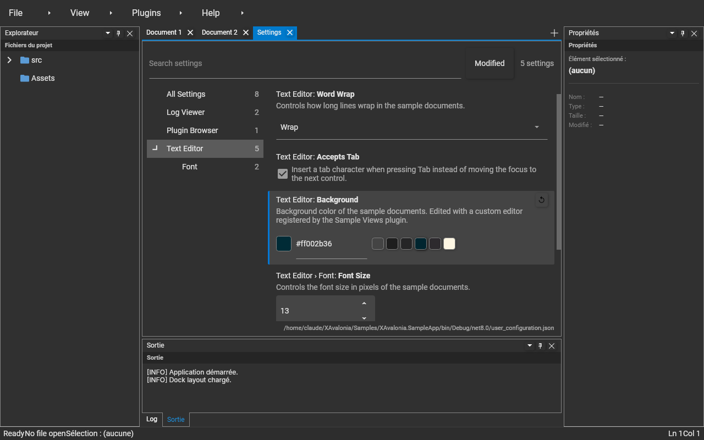

# PropertyInspector

`PropertyInspector` (assembly **XAvalonia.Controls**, namespace `XAvalonia.Controls`) displays a list of editable properties in the style of the Visual Studio Code settings editor.
Each row shows its category and label, its description and an editor picked by value type from an **editor registry**. Modified properties have an accent bar and a ↺ button that resets them.

The settings editor (XAvalonia.UserSettings) is built on it, and any plugin can reuse it, for example in a properties panel.



---

## Using the control

```xml
<UserControl xmlns:controls="using:XAvalonia.Controls" …>
  <controls:PropertyInspector Items="{Binding Properties}"
                              FilterText="{Binding SearchText}"
                              CategoryFilter="{Binding SelectedCategoryPath}"
                              ShowModifiedOnly="{Binding ShowModifiedOnly}"
                              EditorRegistry="{Binding EditorRegistry}" />
</UserControl>
```

| Property | Type | Role |
|---|---|---|
| `Items` | `IEnumerable<IPropertyItem>` | Properties to display, in order. An `INotifyCollectionChanged` source is followed. |
| `FilterText` | `string?` | Space-separated terms; each must occur in the label, key, category or description. |
| `CategoryFilter` | `string?` | Category path to show, sub-categories included (`"Text Editor"` also shows `"Text Editor/Font"`). Empty shows all. |
| `ShowModifiedOnly` | `bool` | Only items whose `IsModified` is `true`. |
| `EditorRegistry` | `IPropertyEditorRegistry?` | Where editors come from. `null` uses the built-in editors only. |
| `EmptyText` | `string` | Text shown when `Items` is empty. |
| `VisibleCount` | `int` (read-only) | Number of rows displayed. |

`PropertyItemFilter` exposes the same matching (`SplitTerms`, `Matches`, `IsInCategory`) so a host can compute counts, e.g. per node of a category tree.

---

## Describing a property: IPropertyItem

```csharp
public interface IPropertyItem : INotifyPropertyChanged
{
    string Key { get; }            // stable id, tooltip, searchable
    string DisplayName { get; }
    string Description { get; }
    string Category { get; }       // "A/B" path
    Type ValueType { get; }        // selects the editor
    object? Value { get; set; }    // setting it applies the change
    bool IsModified { get; }
    bool IsReadOnly { get; }
    double? Minimum { get; }
    double? Maximum { get; }
    void Reset();
}
```

Raise `PropertyChanged` for `Value` and `IsModified` so editors and markers stay in sync. The `Value` setter reports its own errors (validation, persistence) instead of throwing to the editor.

---

## Registering an editor for a data type

The shell registers one `IPropertyEditorRegistry` service (implementation `PropertyEditorRegistry`), preloaded with:

| Type | Editor |
|---|---|
| `bool`, `bool?` | Check box, with the description as its label |
| `int`, `double` (and nullable) | Numeric up-down, bounded by `Minimum` / `Maximum` |
| `string` | Text box, committed on Enter or focus loss |
| any enum (registered on `Enum`) | Combo box |
| anything else | Read-only text (`PropertyEditorRegistry.Fallback`) |

Lookup order for a value type: the type itself, its nullable underlying type, its base types, then its interfaces. So registering `Enum` covers every enum, and registering a type replaces the built-in editor for it.

A plugin registers its editors in `Initialize`:

```csharp
IPropertyEditorRegistry? lRegistry = pServiceManager.TryRequestService<IPropertyEditorRegistry>();
lRegistry?.Register<Color>(new ColorPropertyEditor());

// or, for a quick one, a factory:
lRegistry?.Register<TimeSpan>(pItem => new TextBlock { Text = pItem.Value?.ToString() });
```

Open inspectors rebuild their rows when the registry changes (`EditorsChanged`).

### Writing an editor

Derive from `PropertyEditorBase<TControl>`. It keeps the control and the item in sync in both directions, and observes the item only while the control is in the visual tree:

```csharp
public sealed class ColorPropertyEditor : PropertyEditorBase<ColorPropertyEditor.EditorPanel>
{
    protected override EditorPanel CreateControl(IPropertyItem pItem) => new EditorPanel();

    // Item → control (never written back).
    protected override void UpdateControl(EditorPanel pControl, IPropertyItem pItem)
        => pControl.HexBox.Text = (pItem.Value as Color?)?.ToString();

    // Control → item.
    protected override void ObserveControl(EditorPanel pControl, IPropertyItem pItem, Action<object?> pCommit)
        => pControl.HexBox.LostFocus += (_, _) =>
           {
               if (Color.TryParse(pControl.HexBox.Text, out Color lColor)) pCommit(lColor);
           };
}
```

The full example lives in `Samples/XAvalonia.Sample.Views/ColorPropertyEditor.cs`: a swatch, a hexadecimal text box and preset colors, used by the **Text Editor › Background** setting.
A plugin may also implement `IPropertyEditor` directly with only `XAvalonia.Shell.Abstractions`.

> `XAvalonia.Controls` is loaded by the host (XAvalonia.Bootstrap references it), so plugins that reference it share the same types.
