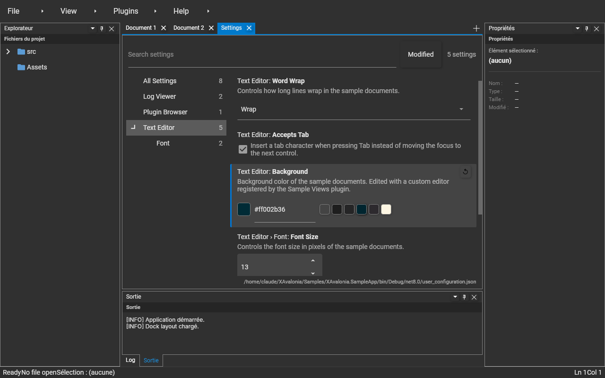

# IUserConfiguration

Gives plugins read **and write** access to `user_configuration.json`, the file holding the settings a user may change.
Every plugin property decorated with `[UserConfiguration]` becomes a **setting**: the shell describes it, binds it from the file before `Initialize`, and lets a settings editor change it at runtime.

The implementation is a core service of `XAvalonia.Bootstrap`: it is always registered.
The **XAvalonia.UserSettings** plugin provides the settings editor UI (File › Settings…), in the spirit of the Visual Studio Code settings editor.



---

## Declaring settings

```csharp
public sealed class MyEditorPlugin : IPlugin
{
    [UserConfiguration("editor.fontSize",
        DisplayName = "Font Size",              // default: the key, humanized ("Editor Font Size")
        Category    = "Text Editor/Font",       // tree path, '/'-separated; default: the plugin Name
        Description = "Font size in pixels.",
        Order       = 10,                       // position inside the category
        Minimum     = 6, Maximum = 72)]         // numeric bounds (optional)
    public double FontSize { get; set; } = 13;  // initial value = default value

    [UserConfiguration("editor.wordWrap", Category = "Text Editor")]
    public TextWrapping WordWrap { get; set; } = TextWrapping.Wrap;
    …
}
```

Supported types: `string`, `bool`, `int`, `double`, their nullable forms, enums (stored by name), and any type
convertible from a string, through a `TypeConverter` or a public static `Parse(string)` (e.g. `TimeSpan`, `Guid`, Avalonia's `Color`), stored as a string.
The value of the property **before** the file is applied is recorded as the setting's default value, used by "Reset to default".

The section in the file is the plugin class name without the `Plugin` suffix, or the `[ConfigurationSection]` name:

```json
{
  "MyEditor": {
    "editor.fontSize": 16,
    "editor.wordWrap": "NoWrap"
  }
}
```

Only the settings the user changed are written to the file, like VS Code's `settings.json`.

---

## Interface

```csharp
public interface IUserConfiguration : IJsonSectionProvider
{
    event EventHandler<UserSettingChangedEventArgs>? SettingChanged;

    string FilePath { get; }
    IReadOnlyList<UserSettingDescriptor> Settings { get; }

    object? GetValue(UserSettingDescriptor pSetting);
    bool IsModified(UserSettingDescriptor pSetting);          // explicitly set in the file
    void SetValue(UserSettingDescriptor pSetting, object? pValue);
    void ResetValue(UserSettingDescriptor pSetting);
}
```

`SetValue` converts the value to the setting type, clamps numbers to `Minimum`/`Maximum`, updates the plugin property, raises `SettingChanged`, then saves the file.
`ResetValue` removes the key from the file and restores the default value.
Both throw `IOException` when the file cannot be written; the new value still applies until the application exits.
A file that is not valid JSON is never overwritten.

---

## Reacting to changes

The plugin property already holds the new value when `SettingChanged` is raised, so a plugin only has to re-apply it:

```csharp
public void Initialize(IPluginServiceManager pServiceManager)
{
    ApplySettings();

    IUserConfiguration? lUserConfiguration = pServiceManager.TryRequestService<IUserConfiguration>();
    if (lUserConfiguration is not null)
    {
        lUserConfiguration.SettingChanged += (_, pArgs) =>
        {
            if (pArgs.Setting.PluginId == Id)
            {
                ApplySettings();
            }
        };
    }
}
```

A plugin that reads its settings only in `Initialize` simply takes changes into account at the next start.

---

## Settings editor (XAvalonia.UserSettings)

- **File › Settings…** opens a `Settings` document tab (in a `Tools` menu when no `File` menu exists).
- Category tree on the left, with the number of matching settings per category; **All Settings** lists everything.
- Search box: every word must match the title, key, category or description; categories without matches are hidden.
- **Modified** toggle: only the settings set in the file.
- The list is a [PropertyInspector](Control_PropertyInspector.md): one editor per type, check box (`bool`), numeric up-down (`int`, `double`), text box (`string`, saved on Enter or focus loss), combo box (enums), and any editor a plugin registered in `IPropertyEditorRegistry` for its own types.
- Modified settings show an accent bar and a ↺ button that resets them.
- Changes are saved immediately; the file path and save errors are shown at the bottom.
